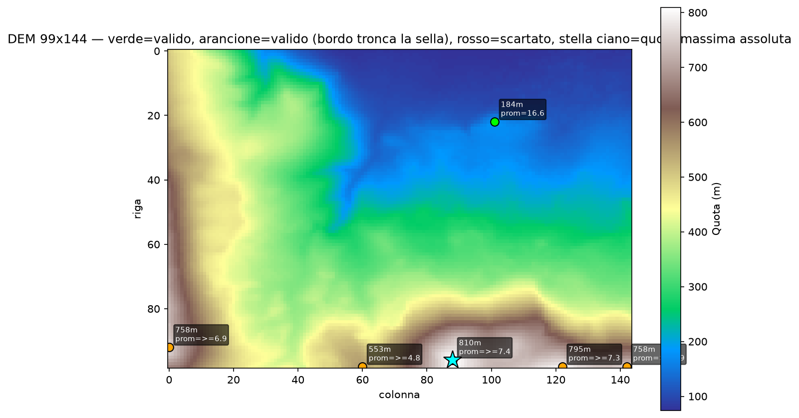
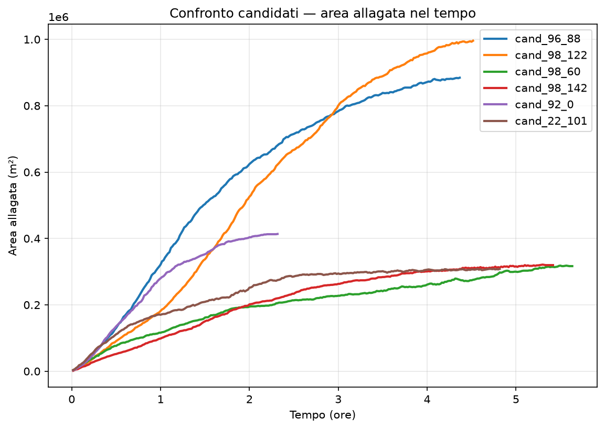
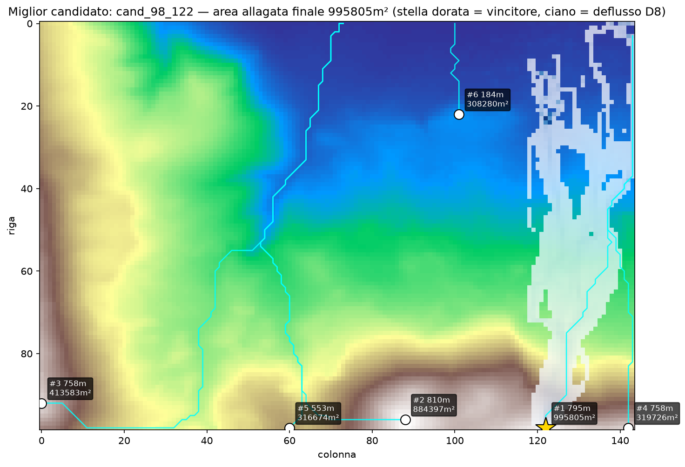
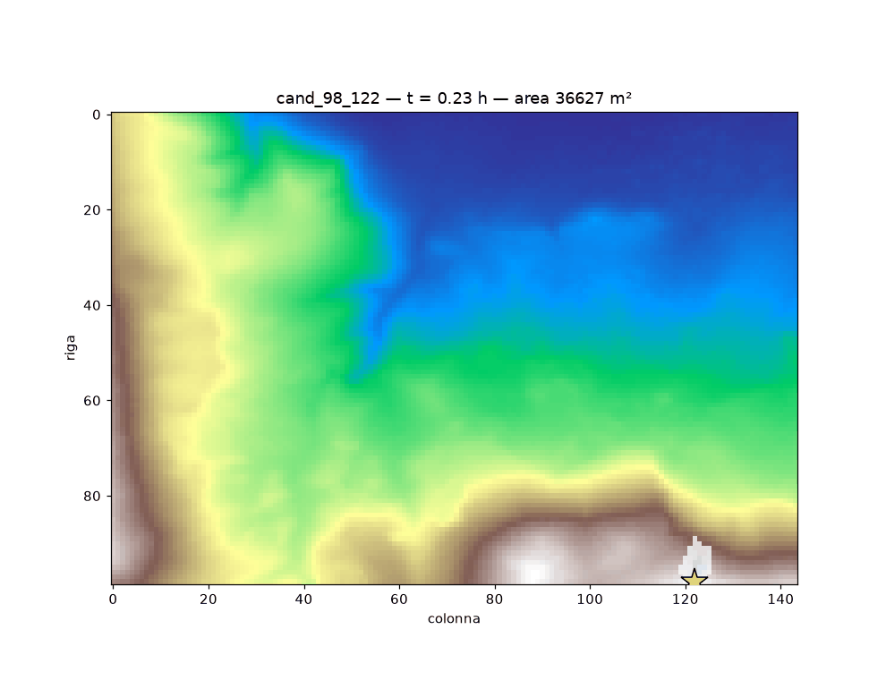
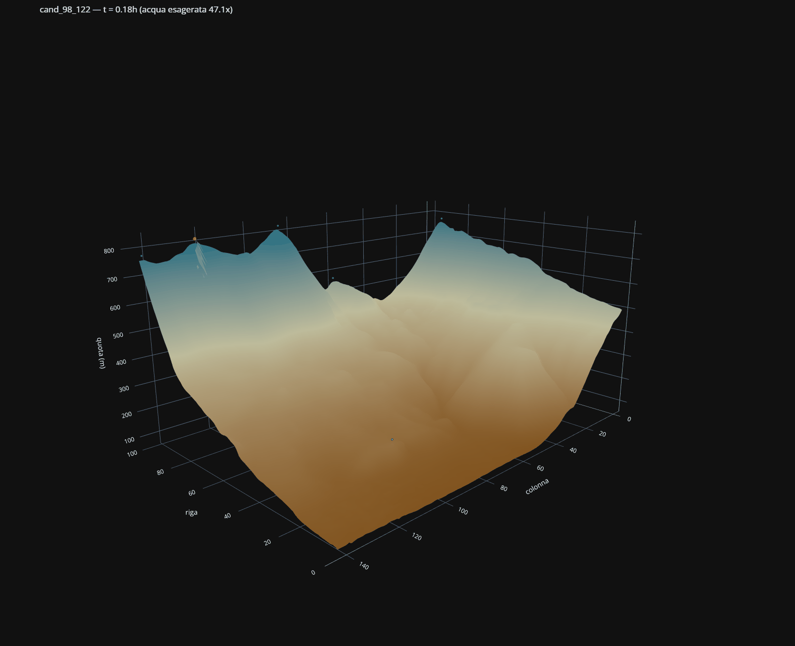
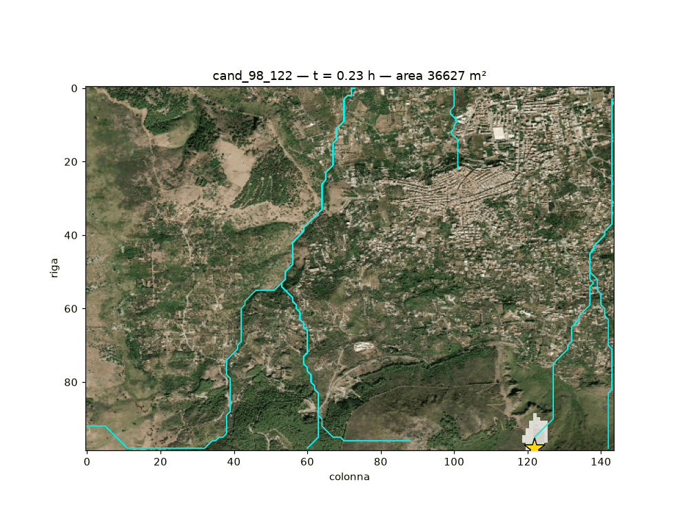
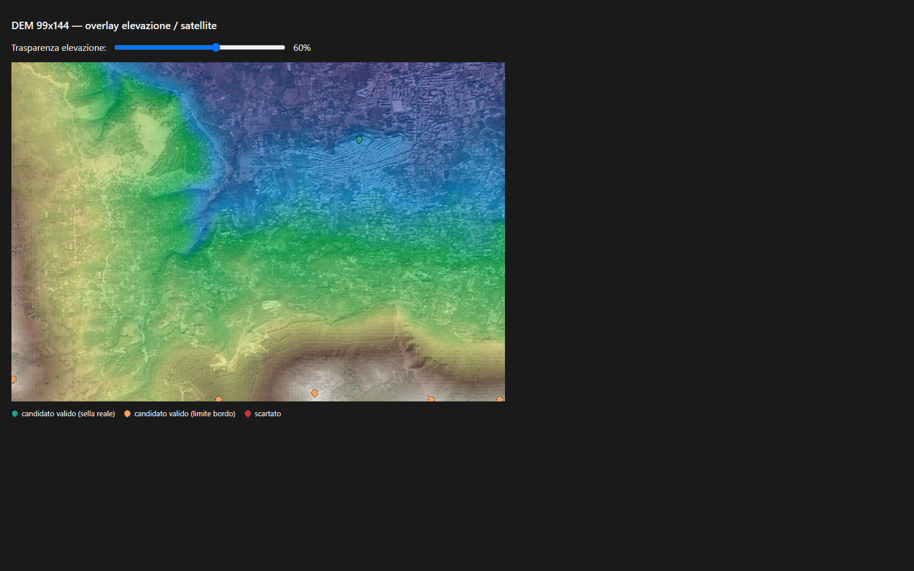
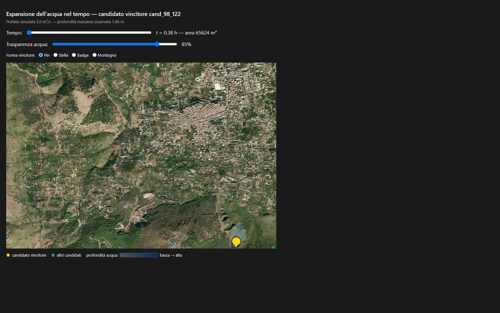
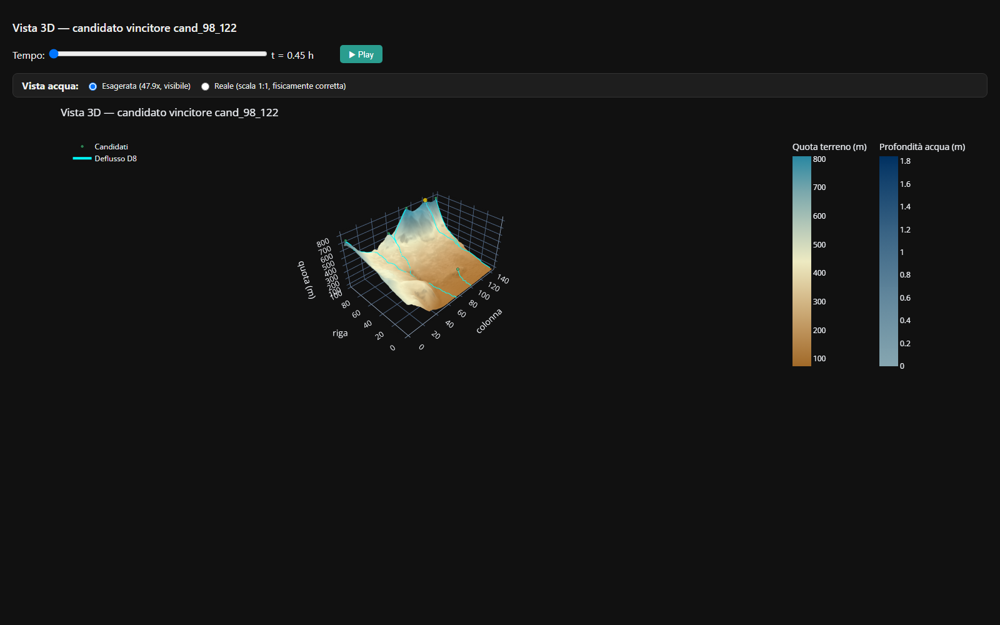
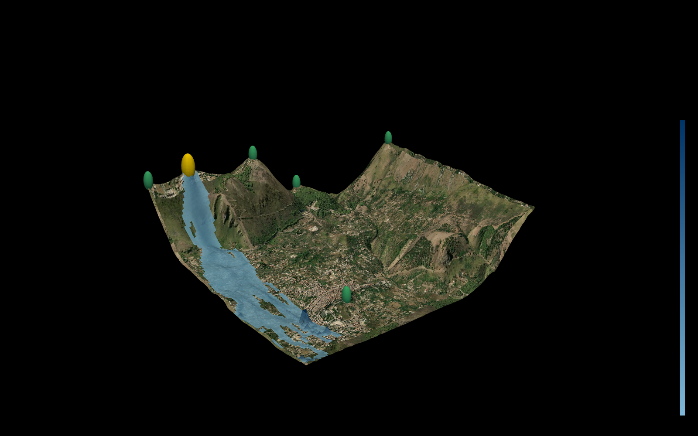

# Watershed-AI

Pipeline di analisi del terreno che, a partire da un DEM, individua il miglior punto di immissione acqua per uno scenario di allagamento, classificato per area allagata simulata.

[Read in English](README.md)

> Progetto esplorativo personale, esterno a qualsiasi percorso accademico.
> Autore: Vicio Di Cara

---

## Cos'è

Watershed-AI prende un modello digitale di elevazione (DEM) e trova il punto migliore per immettere acqua in uno scenario di allagamento — non semplicemente il punto più alto, ma quello che allaga la superficie maggiore. Valuta diversi punti candidati (massimi locali filtrati per prominenza), esegue una simulazione di allagamento a cellular automata per ciascuno, e li classifica per area/volume allagato. È pensato per chi vuole esplorare scenari di terreno/rischio idraulico a partire da un DEM — appassionati di idrologia, smanettoni GIS, o chiunque voglia un esempio funzionante di modellazione dell'allagamento su raster — non è uno strumento di previsione alluvionale professionale. Il cuore è calcolo raster deterministico NumPy/SciPy; non c'è alcuna componente di machine learning o LLM nonostante il naming `Agent`/`Orchestrator` (vedi [Stato del progetto](#stato-del-progetto--cosa-manca)).

## Come funziona

| Fase | Passo | Input → Output |
|---|---|---|
| 1 | **Ingestion** | sorgente dati (oggi solo DEM pubblico; mappa scansionata / LiDAR / fotogrammetria drone previste) → griglia di elevazione pulita |
| 2 | **Candidate selection** | DEM → N punti candidati (massimi locali filtrati per prominenza, non un semplice argmax) |
| 3 | **Flood simulation** | per candidato → curva Area(t) / Area(Volume) tramite espansione acqua a cellular automata |
| 4 | **Ranking & output** | grafico di confronto, mappa ipsometrica con overlay acqua, animazione temporale |

```
DEM  →  [1] ingestion  →  [2] selezione candidati  →  [3] simulazione allagamento (per candidato)  →  [4] ranking + mappa/animazione
```

## Risultati

DEM con i punti candidati individuati:



Confronto dell'area allagata nel tempo tra i candidati:



Mappa finale con i candidati valutati e il vincitore (stella dorata = maggiore area allagata):



Espansione dell'allagamento nel tempo, vista dall'alto:



Stessa simulazione in vista 3D sul terreno:



Stessa simulazione in vista 3D su immagine satellitare:



Elevazione del DEM sovrapposta a immagine satellitare (HTML interattivo, cattura statica):



Mappa time-lapse interattiva dell'allagamento (HTML interattivo, cattura statica):



Vista 3D interattiva dell'allagamento per il candidato vincitore (HTML interattivo, cattura statica):



Vista 3D interattiva del terreno satellitare (HTML interattivo, cattura statica):



## Quickstart

```bash
# 1. venv + dipendenze
python -m venv .venv
source .venv/Scripts/activate      # Windows (bash). Linux/macOS: source .venv/bin/activate
pip install -r requirements.txt

# 2. download una-tantum di Chrome per kaleido (serve allo script di export animazione 3D)
plotly_get_chrome -y

# 3. DEM di test — già incluso nel repo, nessun download necessario
ls data/dem/copernicus_glo30_test.tif

# 4. esegui la pipeline completa (ingestion → candidati → simulazione → ranking → mappa statica)
python -m scripts.test_fase4
# → output/maps/<timestamp>__fase4_final_map.png

# 5. esegui una visualizzazione interattiva (genera HTML, apri nel browser)
python -m scripts.visualize_flood_timelapse
# → output/maps/<timestamp>__flood_timelapse.html
```

> **Windows**: `richdem`, `pysheds`, `whitebox` non hanno wheel precompilate per Windows/Python 3.13 e falliscono senza Visual Studio Build Tools. Installarli via conda-forge:
> ```bash
> conda create -n watershed python=3.12
> conda activate watershed
> conda install -c conda-forge richdem pysheds whitebox gdal
> pip install -r requirements.txt
> ```

Con Docker (include Redis per cache DEM — attualmente inutilizzato, vedi [Stato del progetto](#stato-del-progetto--cosa-manca)):
```bash
cp .env.example .env
docker compose up --build
```

## Strumenti di visualizzazione — quale usare per cosa

Vivono tutti in `scripts/` e lavorano direttamente su `app/hydrology/` + `app/ingestion/public_dem.py` — nessuno passa da `app/agents/Orchestrator` (vedi [Stato del progetto](#stato-del-progetto--cosa-manca)). Ogni script legge `data/dem/copernicus_glo30_test.tif` come default (path hardcoded, nessun argomento CLI).

| Voglio... | Script | Output |
|---|---|---|
| Eseguire tutta la pipeline, ottenere la mappa di ranking finale | `python -m scripts.test_fase4` | PNG statico |
| Vedere la curva di confronto Area(t) tra tutti i candidati | `python -m scripts.test_fase3` | PNG statico |
| Verifica rapida: il DEM si carica correttamente (shape, range quota, quality flags) | `python -m scripts.test_load_dem` | solo console |
| Verifica rapida: quali punti candidati sono stati trovati e perché | `python -m scripts.test_fase2` / `python -m scripts.diagnose_candidates` | solo console |
| Animazione 2D condivisibile (vista dall'alto) | `python -m scripts.export_flood_animation` | GIF + MP4 |
| Animazione 3D condivisibile sul DEM (lenta, ~2-3 min, via kaleido) | `python -m scripts.export_flood_animation_3d` | GIF + MP4 |
| Animazione 3D condivisibile su immagine satellitare (richiede internet) | `python -m scripts.export_flood_animation_satellite` | GIF + MP4 |
| Mappa statica DEM + punti candidati | `python -m scripts.visualize_dem` | PNG statico |
| Overlay interattivo DEM/satellite, slider trasparenza (richiede internet) | `python -m scripts.visualize_dem_satellite` | HTML |
| Vista 3D interattiva dell'allagamento per il candidato vincitore (con percorsi di deflusso D8), no satellite | `python -m scripts.visualize_flood_3d` | HTML |
| Heatmap accumulo di flusso D8 + terreno 3D statico con percorsi di deflusso (matplotlib, senza kaleido) | `python -m scripts.visualize_flow_routing` | 2 PNG statici |
| Time-lapse interattivo dell'allagamento su immagine satellitare reale (richiede internet) | `python -m scripts.visualize_flood_timelapse` | HTML |
| Terreno 3D + satellite interattivo, senza animazione acqua (richiede internet + PyVista) | `python -m scripts.visualize_terrain_satellite_3d` | HTML |
| App 3D interattiva completa, server live (richiede internet + PyVista/trame) | `python -m scripts.app_terrain_satellite_3d_interactive` | server su `http://localhost:8080` |
| Verifica dell'installazione PyVista/trame stessa | `python -m scripts.diagnose_trame_minimal` | server di smoke test |

## Stato del progetto / cosa manca

Stato onesto basato su un audit completo del codice con esecuzione reale (`docs/AUDIT-STATO-REALE.md`, 2026-07-21) — non aspirazionale.

**Funziona oggi, verificato eseguendolo:** candidate detection, riempimento depressioni (priority-flood), flow routing D8 (direzione, accumulo, percorsi di deflusso; D-infinity/MFD non implementati), simulazione allagamento a cellular automata, ranking, rendering mappa statica, e tutti i 16 script in `scripts/` (14 producono output verificato su disco, 2 sono server interattivi che partono correttamente). È la pipeline descritta sopra e mostrata negli screenshot.

**Non funziona — stub (`raise NotImplementedError`), mai completato:**
- `app/ingestion/lidar_processing.py` — ingestion point cloud LiDAR (`extract_dem_from_lidar`) **non implementata**. Nessun dato `.las`/`.laz` di test presente nel repo.
- `app/ingestion/contour_extraction.py` — ingestion da mappa topografica scansionata (OCR + vettorizzazione curve di livello) — non implementata.
- `app/ingestion/drone_photogrammetry.py` — ingestion da fotogrammetria drone — non implementata, esplicitamente marcata come placeholder per una fase futura.
- `app/ingestion/public_dem.py: download_public_dem()` — download automatico del DEM — non implementato; funziona solo il caricamento di un GeoTIFF locale già presente (`load_dem_from_geotiff()`), che è quello effettivamente usato da ogni script.
- `app/agents/visualization_agent.py` — non implementato.
- `app/viz/animation_builder.py`, `app/viz/comparison_charts.py` — non implementati come moduli, ma la stessa funzionalità (animazioni, grafico di confronto) funziona ed è testata — è duplicata direttamente dentro `scripts/`, bypassando completamente questi moduli.
- `app/services/dem_cache.py` — cache DEM su Redis — non implementata, mai istanziata da nessuna parte.
- `app/services/report_builder.py` — generazione report Markdown/PDF — non implementata, e a differenza di animazioni/grafici, non esiste alcun equivalente in `scripts/`. Questo output non esiste in nessuna forma oggi.
- `app/main.py` → `Orchestrator.run()` — **il punto di ingresso CLI ufficiale non funziona end-to-end.** Fallisce sempre al primo step della pipeline (`DemIngestAgent.process()` è uno stub). La pipeline che funziona davvero è raggiungibile solo attraverso gli script in `scripts/`, non tramite `python -m app.main`.
- Nessun LLM in nessun punto del codice. Il naming `Agent`/`Orchestrator` è una convenzione architetturale (segue lo stesso pattern usato in altri progetti dell'autore), non intelligenza artificiale autonoma — nessun loop di ragionamento, nessun tool-calling, nessun client LLM in `requirements.txt`.

## Requisiti di sistema

- **Python 3.12** raccomandato (corrisponde al venv di sviluppo: `Python 3.12.10`). Python 3.13 rompe `richdem`/`pysheds`/`whitebox` su Windows (nessuna wheel precompilata — vedi la nota conda nel Quickstart).
- **Windows + pacchetti geospaziali**: `richdem`, `pysheds`, `whitebox` tentano di compilare da sorgente su Windows e falliscono senza Visual Studio Build Tools. Usare l'installazione conda-forge mostrata nel Quickstart invece di combattere col compilatore.
- **Comando una-tantum dopo `pip install -r requirements.txt`**: `plotly_get_chrome -y` (o `kaleido_get_chrome`) — `kaleido>=1.0` (la versione installata è `1.3.0`) richiede un download dedicato di Chrome headless per l'export statico di immagini Plotly, usato da `scripts/export_flood_animation_3d.py`. Non documentato altrove nel repo.
- **`ffmpeg`** deve essere disponibile nel `PATH` per la parte MP4 degli script di export animazione (l'export GIF non ne ha bisogno).
- **Stack PyVista / VTK / trame** — usato da `visualize_terrain_satellite_3d.py`, `app_terrain_satellite_3d_interactive.py` e `diagnose_trame_minimal.py` — **non è elencato in `requirements.txt`**. Un `pip install -r requirements.txt` pulito non basta a far girare questi 3 script; installare manualmente: `pip install pyvista vtk trame trame-vtk trame-vuetify`.
- **Accesso a internet** — 5 script chiamano il servizio pubblico Esri World Imagery (nessuna API key, ma è una dipendenza di rete reale): `visualize_dem_satellite.py`, `visualize_flood_timelapse.py`, `visualize_terrain_satellite_3d.py`, `export_flood_animation_satellite.py`, `app_terrain_satellite_3d_interactive.py`.

## Struttura

```
app/
├── agents/       # orchestrator + una classe per fase (per lo più inutilizzato, vedi stato sopra)
├── ingestion/    # sorgenti dati → DEM (funziona solo il ramo file locale di public_dem.py)
├── hydrology/    # flow routing D8, candidate detection, priority-flood, cellular automata
├── viz/          # mappe, animazioni, grafici comparativi (animazioni/grafici sono stub, vedi stato sopra)
├── services/     # cache DEM (Redis), report builder — entrambi non implementati
└── core/         # tipi di dominio, config, eccezioni

data/             # raw / dem / public_dem_cache (mai versionati, vedi .gitignore)
output/           # maps / animations / reports (generati, mai versionati)
docs/assets/      # immagini per questo README
scripts/          # la pipeline che funziona davvero — vedi la tabella strumenti sopra
tests/
```

## Note metodologiche

- Il punto più alto non è il migliore: la selezione dei candidati passa sempre da prominenza, mai da un semplice argmax sulla quota.
- I sink/depressioni spurie vanno sempre riempite (priority-flood) prima di ogni simulazione.
- La risoluzione del DEM conta più della sofisticazione dell'algoritmo: segnalare sempre quando i risultati si basano su DEM pubblici a bassa risoluzione (es. SRTM/Copernicus 30m).

## Licenza / crediti

[MIT](LICENSE) — Copyright (c) 2026 Vicio Di Cara.
