# Watershed-AI

Terrain-analysis pipeline that turns a DEM into the best flood-injection point, ranked by simulated flooded area.

[Leggi in italiano](README.it.md)


# Watershed-AI

Pipeline che analizza un modello digitale del terreno (DEM) per
individuare i punti ottimali da cui immettere acqua di mare e simulare
la sua espansione — nato per esplorare, a livello computazionale, lo
stesso problema che l'organizzazione [Real Ice](https://www.realice.eco/)
affronta sul campo nell'Artico: dove pompare acqua di mare sul ghiaccio
per farlo ispessire più velocemente e contrastarne lo scioglimento estivo.
> Exploratory personal project, external to any academic program.
> Author: Vicio Di Cara

---

## What it is

Watershed-AI takes a digital elevation model (DEM) and finds the best point to inject water for a flood scenario — not just the highest point, but the one that floods the largest area. It evaluates several candidate points (local maxima filtered by prominence), runs a cellular-automata flood simulation for each one, and ranks them by flooded area/volume. It's meant for anyone exploring terrain/flood-risk scenarios from a DEM — hydrology hobbyists, GIS tinkerers, or anyone who wants a runnable example of raster-based flood modeling — not a production flood-forecasting tool. The core is deterministic NumPy/SciPy raster computation; there is no machine-learning or LLM component despite the `Agent`/`Orchestrator` naming (see [Project status](#project-status--whats-missing)).

## How it works

| Phase | Step | Input → Output |
|---|---|---|
| 1 | **Ingestion** | data source (public DEM today; scanned map / LiDAR / drone photogrammetry planned) → clean elevation grid |
| 2 | **Candidate selection** | DEM → N candidate points (local maxima filtered by prominence, not a plain argmax) |
| 3 | **Flood simulation** | per candidate → Area(t) / Area(Volume) curve via cellular-automata water spread |
| 4 | **Ranking & output** | comparison chart, hypsometric map with water overlay, time-lapse animation |

```
DEM  →  [1] ingestion  →  [2] candidate selection  →  [3] flood simulation (per candidate)  →  [4] ranking + map/animation
```

## Results

DEM with detected candidate points:

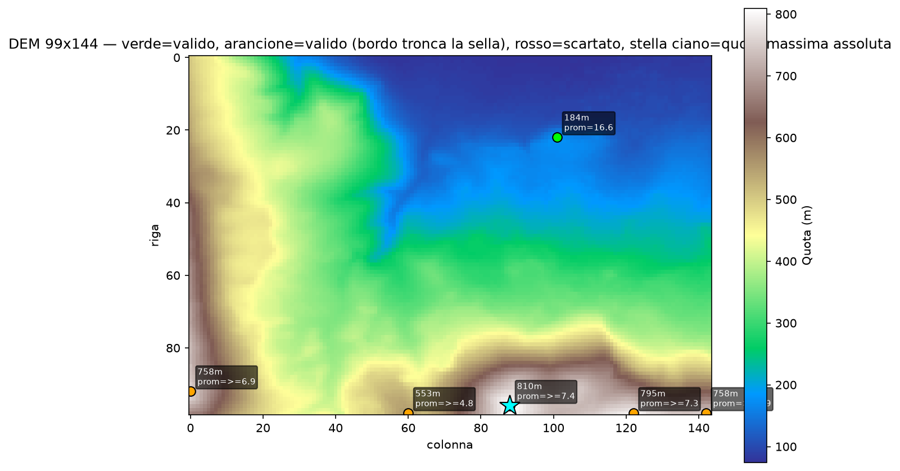

Comparison of flooded area over time across candidates:

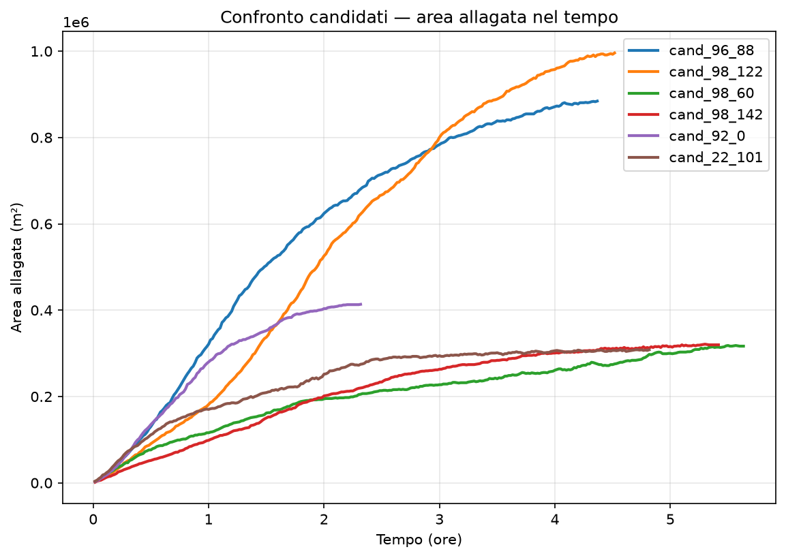

Final ranking map with all evaluated candidates and the winner (gold star = largest flooded area, cyan lines = D8 flow paths from each candidate):

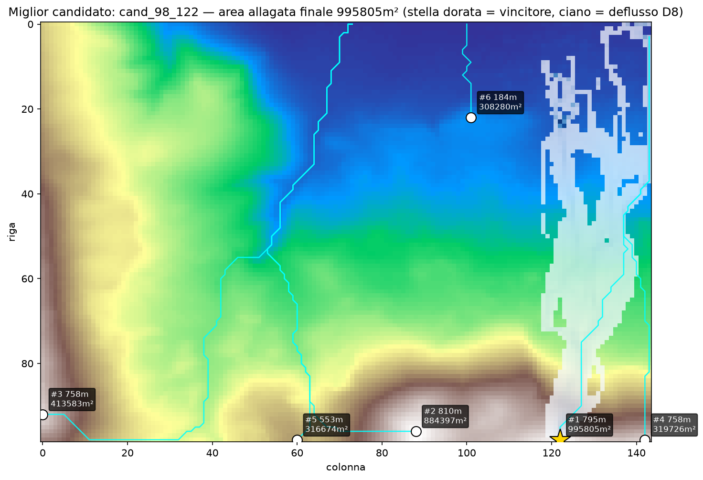

Flood expansion over time, top-down view:

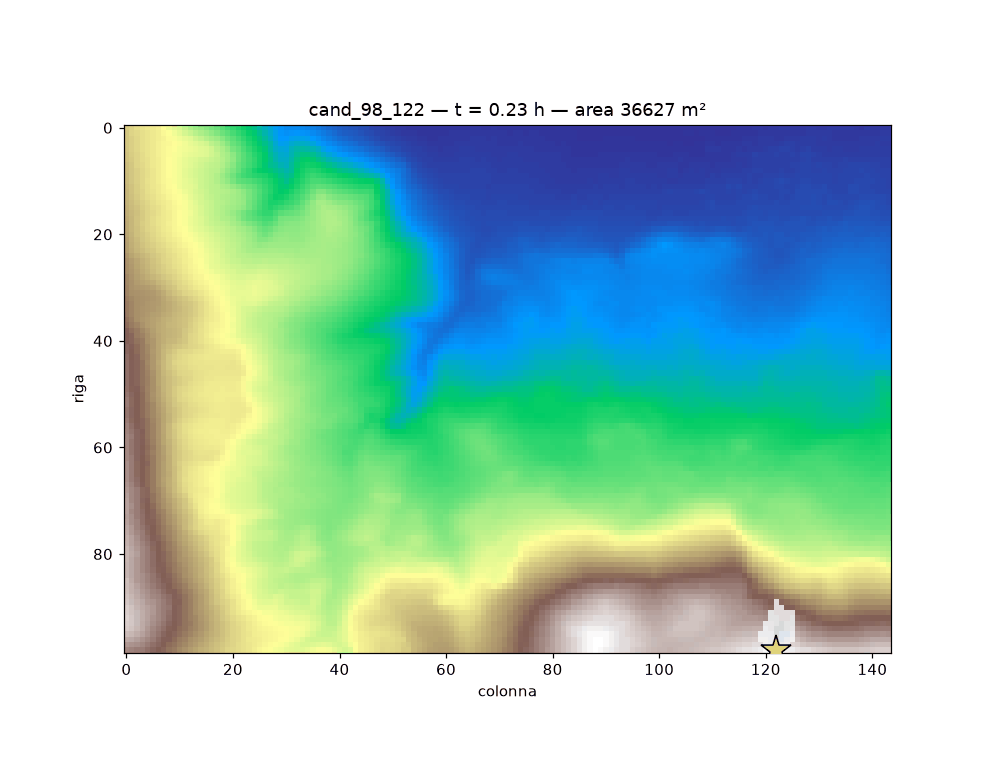

Same simulation, 3D terrain view:

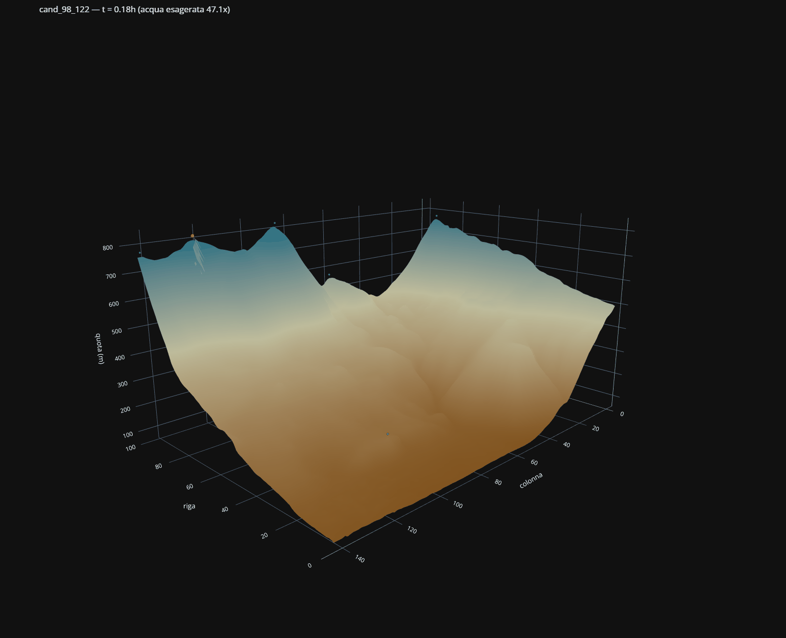

Same simulation, top-down 2D view over satellite imagery:

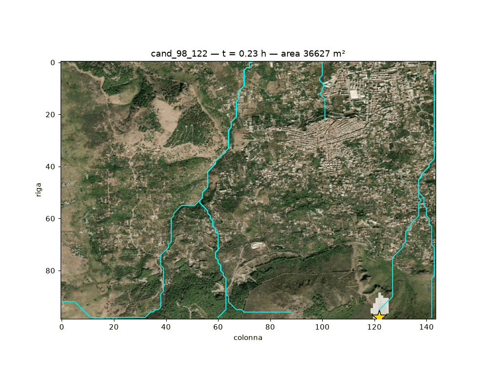

DEM elevation overlaid on satellite imagery (interactive HTML, static capture):

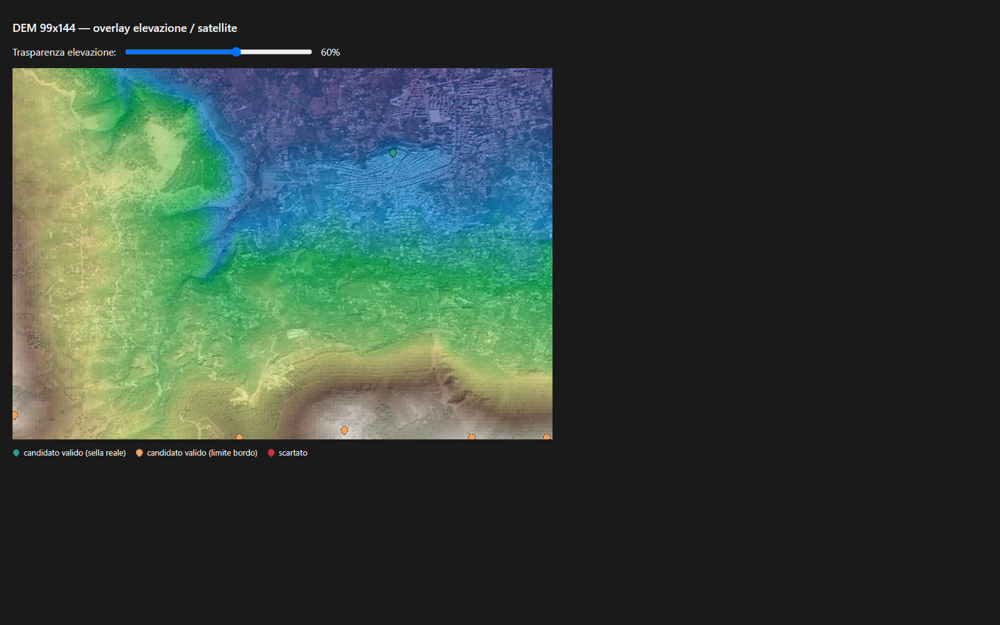

Interactive flood time-lapse map (interactive HTML, static capture):

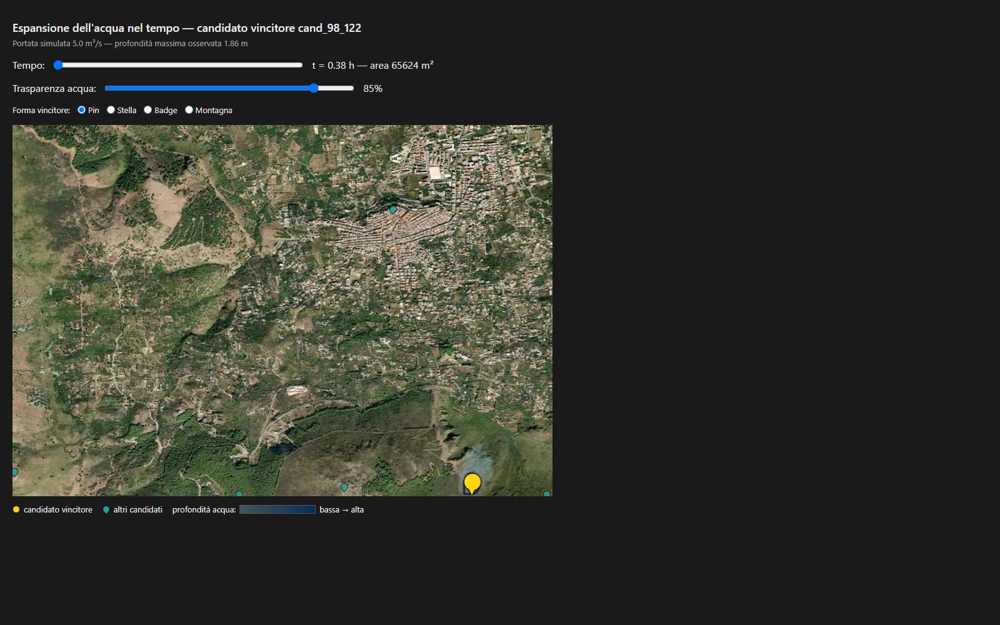

Interactive 3D flood view for the winning candidate (interactive HTML, static capture):

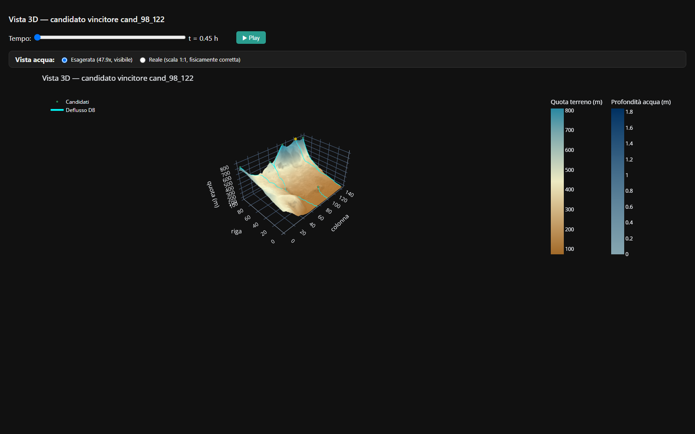

Interactive 3D satellite terrain view (interactive HTML, static capture):

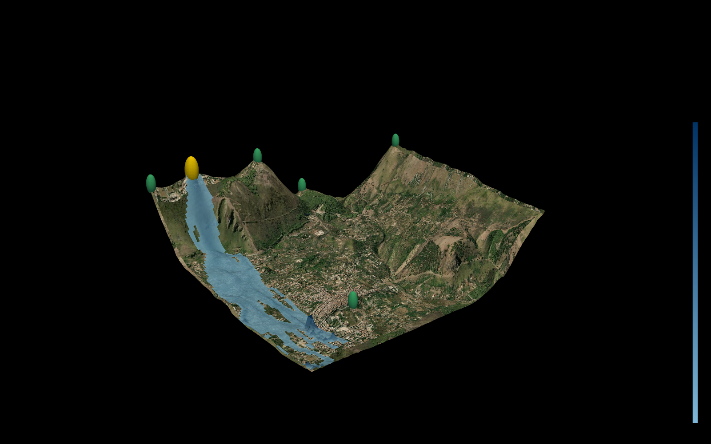

D8 flow accumulation (cells draining into each cell, log scale):

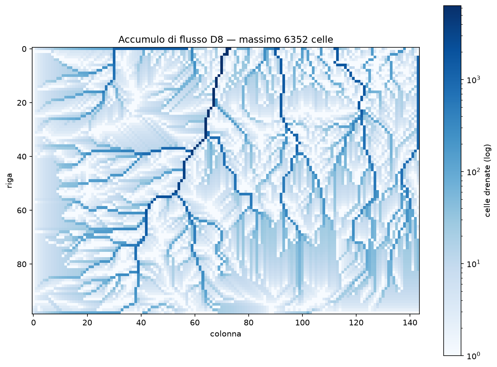

D8 flow paths on the 3D terrain (static matplotlib figure):

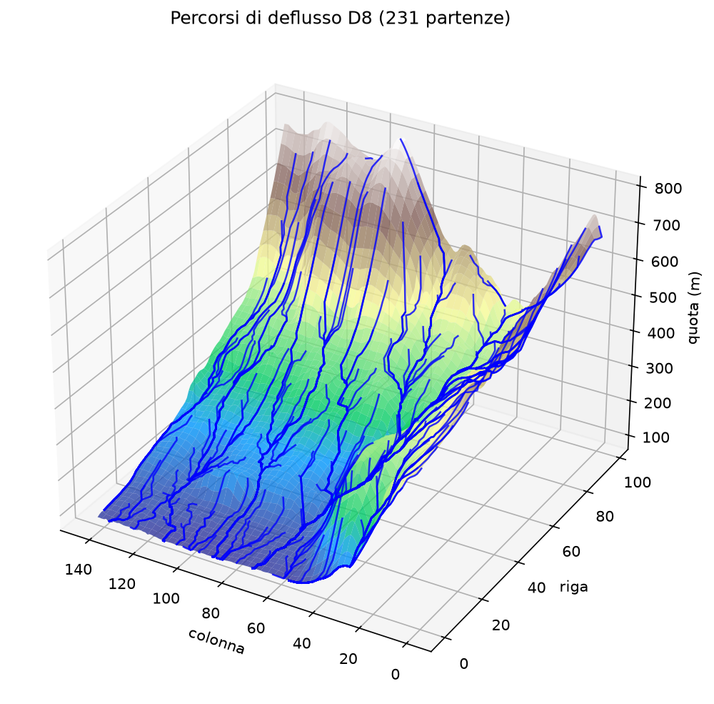

## Quickstart

```bash
# 1. venv + dependencies
python -m venv .venv
source .venv/Scripts/activate      # Windows (bash). Linux/macOS: source .venv/bin/activate
pip install -r requirements.txt

# 2. one-time Chrome download for kaleido (needed by the 3D animation export script)
plotly_get_chrome -y

# 3. test DEM — already included in the repo, no download needed
ls data/dem/copernicus_glo30_test.tif

# 4. run the full pipeline (ingestion → candidates → simulation → ranking → static map)
python -m scripts.test_fase4
# → output/maps/<timestamp>__fase4_final_map.png

# 5. run an interactive visualization (opens as HTML, view in a browser)
python -m scripts.visualize_flood_timelapse
# → output/maps/<timestamp>__flood_timelapse.html
```

> **Windows**: `richdem`, `pysheds`, `whitebox` have no prebuilt wheels for Windows/Python 3.13 and fail to build without Visual Studio Build Tools. Install via conda-forge instead:
> ```bash
> conda create -n watershed python=3.12
> conda activate watershed
> conda install -c conda-forge richdem pysheds whitebox gdal
> pip install -r requirements.txt
> ```

With Docker (includes Redis for DEM caching — currently unused, see [Project status](#project-status--whats-missing)):
```bash
cp .env.example .env
docker compose up --build
```

## Visualization tools — which one to use

All of these live in `scripts/` and run directly against `app/hydrology/` + `app/ingestion/public_dem.py` — none of them go through `app/agents/Orchestrator` (see [Project status](#project-status--whats-missing)). Every script reads `data/dem/copernicus_glo30_test.tif` by default (hardcoded path, no CLI argument).

| I want to... | Script | Output |
|---|---|---|
| Run the whole pipeline, get the final ranking map | `python -m scripts.test_fase4` | static PNG |
| See the Area(t) comparison curve across all candidates | `python -m scripts.test_fase3` | static PNG |
| Quick check: DEM loads correctly (shape, elevation range, quality flags) | `python -m scripts.test_load_dem` | console only |
| Quick check: which candidate points were found and why | `python -m scripts.test_fase2` / `python -m scripts.diagnose_candidates` | console only |
| Shareable 2D flood animation (top-down) | `python -m scripts.export_flood_animation` | GIF + MP4 |
| Shareable 3D flood animation on the DEM (slow, ~2-3 min, via kaleido) | `python -m scripts.export_flood_animation_3d` | GIF + MP4 |
| Shareable 2D flood animation (top-down) over satellite imagery (needs internet) | `python -m scripts.export_flood_animation_satellite` | GIF + MP4 |
| Static DEM + candidate-points map | `python -m scripts.visualize_dem` | static PNG |
| Interactive DEM/satellite overlay, transparency slider (needs internet) | `python -m scripts.visualize_dem_satellite` | HTML |
| Interactive 3D flood view for the winning candidate (with D8 flow paths), no satellite | `python -m scripts.visualize_flood_3d` | HTML |
| D8 flow-accumulation heatmap + static 3D terrain with flow paths (matplotlib, no kaleido) | `python -m scripts.visualize_flow_routing` | 2 static PNG |
| Interactive time-lapse of the flood over real satellite imagery (needs internet) | `python -m scripts.visualize_flood_timelapse` | HTML |
| Interactive 3D terrain + satellite, no flood animation (needs internet + PyVista) | `python -m scripts.visualize_terrain_satellite_3d` | HTML |
| Full interactive 3D app, live server (needs internet + PyVista/trame) | `python -m scripts.app_terrain_satellite_3d_interactive` | server at `http://localhost:8080` |
| Sanity-check the PyVista/trame install itself | `python -m scripts.diagnose_trame_minimal` | server smoke test |

## Project status / what's missing

Honest status based on a full code audit with real execution (`docs/AUDIT-STATO-REALE.md`, 2026-07-21) — not aspirational.

**Works today, verified by running it:** candidate detection, depression filling (priority-flood), D8 flow routing (direction, accumulation, flow paths; D-infinity/MFD not implemented), cellular-automata flood simulation, ranking, static map rendering, and all 16 scripts in `scripts/` (14 produce verified output on disk, 2 are interactive servers that start correctly). This is the pipeline described above and shown in the screenshots.

**Does not work — stub (`raise NotImplementedError`), never completed:**
- `app/ingestion/lidar_processing.py` — LiDAR point-cloud ingestion (`extract_dem_from_lidar`) is **not implemented**. No `.las`/`.laz` test data exists in the repo either.
- `app/ingestion/contour_extraction.py` — scanned topographic map ingestion (OCR + contour vectorization) — not implemented.
- `app/ingestion/drone_photogrammetry.py` — drone photogrammetry ingestion — not implemented, explicitly marked as a placeholder for a later phase.
- `app/ingestion/public_dem.py: download_public_dem()` — automatic DEM download — not implemented; only loading an existing local GeoTIFF (`load_dem_from_geotiff()`) works, and it's the one every script actually uses.
- `app/agents/visualization_agent.py` — not implemented.
- `app/viz/animation_builder.py`, `app/viz/comparison_charts.py` — not implemented as modules, but the same functionality (animations, comparison chart) works and is tested — it's duplicated directly inside `scripts/`, bypassing these modules entirely.
- `app/services/dem_cache.py` — Redis DEM cache — not implemented, never instantiated anywhere.
- `app/services/report_builder.py` — Markdown/PDF report generation — not implemented, and unlike animations/charts, no equivalent exists anywhere in `scripts/` either. This output doesn't exist in any form today.
- `app/main.py` → `Orchestrator.run()` — **the official CLI entry point does not work end-to-end.** It always crashes on the first pipeline step (`DemIngestAgent.process()` is a stub). The pipeline that actually works is only reachable through the scripts in `scripts/`, not through `python -m app.main`.
- No LLM anywhere in the codebase. The `Agent`/`Orchestrator` naming is an architectural convention (following the same pattern as other projects by the author), not autonomous AI — there's no reasoning loop, no tool-calling, no LLM client in `requirements.txt`.

## System requirements

- **Python 3.12** recommended (matches the dev venv: `Python 3.12.10`). Python 3.13 breaks `richdem`/`pysheds`/`whitebox` on Windows (no prebuilt wheels — see Quickstart's conda note).
- **Windows + geospatial packages**: `richdem`, `pysheds`, `whitebox` try to compile from source on Windows and fail without Visual Studio Build Tools. Use the conda-forge install shown in Quickstart instead of fighting the compiler.
- **One-time command after `pip install -r requirements.txt`**: `plotly_get_chrome -y` (or `kaleido_get_chrome`) — `kaleido>=1.0` (the installed version is `1.3.0`) needs its own headless Chrome download for static Plotly image export, used by `scripts/export_flood_animation_3d.py`. This is not documented anywhere else in the repo.
- **`ffmpeg`** must be available on `PATH` for the MP4 side of the animation-export scripts (GIF export doesn't need it).
- **PyVista / VTK / trame stack** — used by `visualize_terrain_satellite_3d.py`, `app_terrain_satellite_3d_interactive.py`, and `diagnose_trame_minimal.py` — is **not listed in `requirements.txt`**. A clean `pip install -r requirements.txt` will not be enough to run those 3 scripts; install manually: `pip install pyvista vtk trame trame-vtk trame-vuetify`.
- **Internet access** — 5 scripts call the public Esri World Imagery tile service (no API key, but a real network dependency): `visualize_dem_satellite.py`, `visualize_flood_timelapse.py`, `visualize_terrain_satellite_3d.py`, `export_flood_animation_satellite.py`, `app_terrain_satellite_3d_interactive.py`.

## Structure

```
app/
├── agents/       # orchestrator + one class per pipeline stage (mostly unused, see status above)
├── ingestion/    # data sources → DEM (only public_dem.py's local-file path actually works)
├── hydrology/    # D8 flow routing, candidate detection, priority-flood, cellular automata
├── viz/          # maps, animations, comparison charts (animations/charts are stubs, see status above)
├── services/     # DEM cache (Redis), report builder — both unimplemented
└── core/         # domain types, config, exceptions

data/             # raw / dem / public_dem_cache (never versioned, see .gitignore)
output/           # maps / animations / reports (generated, never versioned)
docs/assets/      # images used in this README
scripts/          # the pipeline that actually works — see the tool table above
tests/
```

## Methodology notes

- The highest point is not the best one: candidate selection always goes through prominence, never a plain elevation argmax.
- Spurious sinks/depressions must always be filled (priority-flood) before any simulation.
- DEM resolution matters more than algorithm sophistication: always flag results based on low-resolution public DEMs (e.g. SRTM/Copernicus 30m).

## License / credits

[MIT](LICENSE) — Copyright (c) 2026 Vicio Di Cara.
